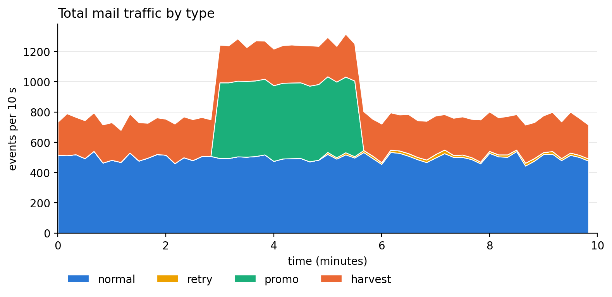
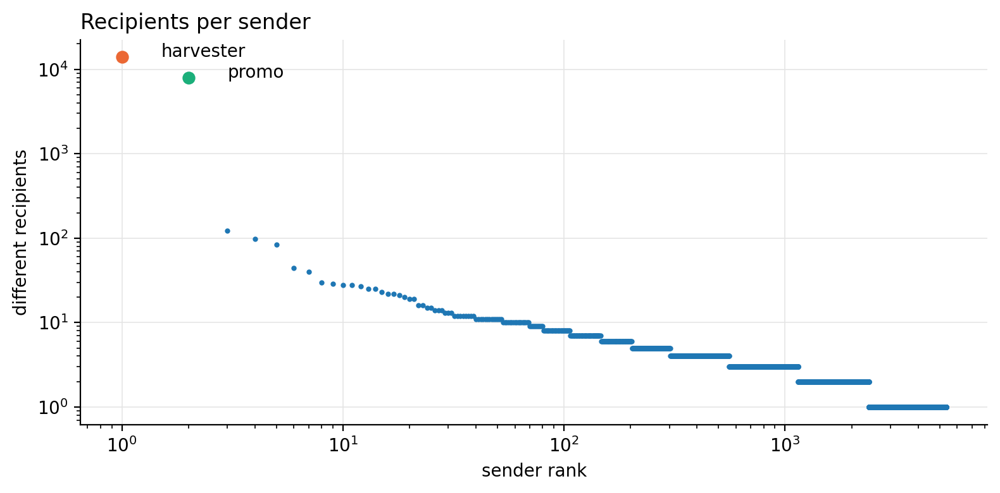

# fourfifty


-brightgreen)


Fourfifty is an email traffic simulator (for now) and an email rate_limiter (soon™️). It works on probabilistic data structures, bloom filter built but not set up for now.


> **Status: week 1 of 2(?).** The traffic simulator, the exact baseline and the Bloom filter is built. Count-Min sketch and HyperLogLog come next.

## Try it

```bash
pip install -e ".[plot]"       # [plot] is optional, only needed for --plot
fourfifty                       # 10-minute simulation, prints traffic tables
fourfifty --duration 300 --seed 7
fourfifty --plot                # also saves total.png and recipients.png
python -m pytest                # run the tests
```

```
TOTAL MAIL TRAFFIC BY EVENT TYPE
--------------------------------
type            events     share
--------------------------------
normal          14,969     52.5%
harvest          7,554     26.5%
promo            6,000     21.0%
--------------------------------
total           28,523


TOP SENDERS BY DIFFERENT RECIPIENTS
--------------------------------------------
sender                            recipients
--------------------------------------------
bot@harvest.example                    7,249
news@letter.example                    6,000
user4943@sender4943.example              102
user19103@sender19103.example             54
user2816@sender2816.example               43
```


The harvester and newsletter are the busiest senders, which makes this a challenge for the rate limiter, since it cant go off bursts alone.
## What's in it

**A traffic simulator with hidden attacks** (`fourfifty/simulator.py`)

Real mail corpus has no answer key of which event is which. A simnulation does, so for the rate_limtier to be scored, traffic needs to be simulated.

**Features:**
* 10,000 senders from a pool of 20,000 mailboxes, Zipf-weighted activity
* every sender has a personal circle of recipients (Pareto-sized, capped at 85% of the pool)
* traffic types:
   * **normal**: normal email activity
   * **harvest**: guesses addresses. around one in five of them  are real.
   * **retry**: a random 3% of normal mail, scheduled out to be sent 5 minutes after
   * **promo**: a newsletter activity burst
* reproducible
* IPs from `198.18.0.0/15` (RFC 2544 benchmarking range) and `.example` domains

**An exact baseline** (`fourfifty/baseline.py`)

the answer key for the rate_limiter
* `emails_per_sender`: what Count-Min will estimate
* `recipients_per_sender`: what HyperLogLog will estimate
* `valid_mboxes`: what the Bloom filter will approximate

**A Bloom filter** (`fourfifty/bloom.py`)

answers wether an address is real or not. works quick but has false positives.
* `bytearray` bit storage, SHA-256 and double hashing for `k` positions
* no false negatives
* false positive rate with m = 10,000 bits, k = 7, 1,000 items: **0.84%** measured vs **0.82%** expected from theory

## What the traffic looks like




The harvesting is steady, as expected. the promotion bursts at minutes 3 to 5. and retries start at minute 5 





HyperLogLog will catch the gap between normal senders and bulk senders, but it wont differentiate between promo and harvest. thats why bloom is needed. 

## Roadmap

* Count-Min sketch (emails per sender)
* HyperLogLog (different recipients per sender)
* scoring harness: sketches vs exact baseline 
* more attack types: compromised accounts & bots
